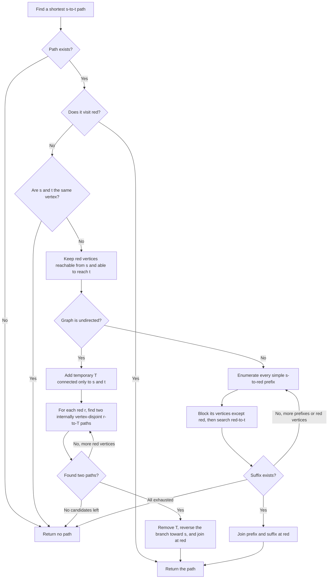

# Some: how the solver works

Some asks whether a **simple** path from `s` to `t` can visit a red vertex.
A simple path never repeats a vertex.



For an undirected graph, the temporary target has only two neighbors: `s` and
`t`. Two paths that share only their endpoints must therefore reach it through
different neighbors. Removing that target gives two branches sharing only red.
NetworkX handles the internal vertex splitting and flow search.

For a directed graph, the solver tries every simple prefix until it finds one
that leaves room for the suffix. It has no retry limit, so the answer stays exact,
but this case can take a long time.

## Run the animation

Open `SomeViz.html` directly. It works offline and needs no installation.
Choose an example from the **Graph** picker, then use **Play**, **Back**, **Next**,
or the step slider. Switching graphs stops playback and starts at the first step.

To regenerate the trace from NetworkX and open it:

```python
%run SomeViz.py
```

Or, from a terminal with the project requirements installed:

```sh
python SomeViz.py
```

The picker includes these inputs from `data/`:

| Graph | What it shows |
| --- | --- |
| `wall-p-2.txt` | The second augmentation cancels `3 → 2` and reroutes the first branch. |
| `G-ex.txt` | The ordinary shortest path already visits red. |
| `P3.txt` | A three-vertex example with a red middle vertex. |
| `wall-p-1.txt` | Two flow branches succeed without cancelling any edge. |
| `wall-n-2.txt` | Only one flow unit fits; no simple path through red exists. |
| `grid-5-0.txt` | A grid whose shortest path already visits red. |
| `increase-n8-3.txt` | Directed prefixes and suffixes; crossed vertices are blocked for the suffix. |

Flow animations use actual NetworkX augmentations. Internal split vertices
are omitted to keep the drawing readable. Directed graphs show their original
edge arrows and use the separate exhaustive prefix search from `SomeProblem.py`.
Every example's final outcome is checked against that solver when regenerating.
