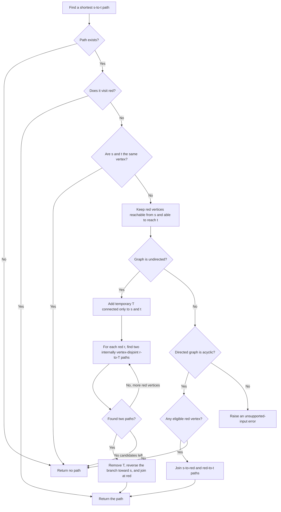

# Some: how the solver works

Some asks whether a **simple** path from `s` to `t` can visit a red vertex.
A simple path never repeats a vertex.



For an undirected graph, the temporary target has only two neighbors: `s` and
`t`. Two paths that share only their endpoints must therefore reach it through
different neighbors. Removing that target gives two branches sharing only red.
NetworkX handles the internal vertex splitting and flow search.

For a directed acyclic graph (DAG), two reachability searches suffice: find
vertices reachable from `s`, and vertices that can reach `t` using reversed
edges. A red vertex in both sets gives a valid simple path. If the two branches
shared another vertex, they would form a directed cycle, which a DAG cannot
contain. This branch runs in **O(n + m)**. All 31 directed inputs in this dataset
are DAGs.

All 154 notebook inputs were audited from their raw edges: 123 are undirected,
and all 31 directed graphs are DAGs (18 `increase` and 13 `ski`). Every directed
edge points forward in a verified topological order. The directed implementation
therefore uses only the DAG method. Its DAG check raises an error if a cyclic
graph reaches this method; there is no exhaustive fallback.

## Run the animation

Open `SomeViz.html` directly. It works offline and needs no installation.
Choose an example from the **Graph** picker, then use **Play**, **Back**, **Next**,
or the step slider. Switching graphs stops playback and starts at the first step.

To regenerate the trace from NetworkX and open it:

```python
%run "visualisations for Some/SomeViz.py"
```

Or, from a terminal with the project requirements installed:

```sh
python "visualisations for Some/SomeViz.py"
```

The picker includes these inputs from `forked_data/`:

| Graph | What it shows |
| --- | --- |
| `wall-p-2.txt` | The second augmentation cancels `3 → 2` and reroutes the first branch. |
| `G-ex.txt` | The ordinary shortest path already visits red. |
| `P3.txt` | A three-vertex example with a red middle vertex. |
| `wall-p-1.txt` | Two flow branches succeed without cancelling any edge. |
| `wall-n-2.txt` | Only one flow unit fits; no simple path through red exists. |
| `grid-5-0.txt` | A grid whose shortest path already visits red. |
| `increase-n8-3.txt` | Two reachability searches find a valid red vertex in a DAG. |

Flow animations use actual NetworkX augmentations. Internal split vertices
are omitted to keep the drawing readable. Directed graphs show their original
edge arrows and use the DAG reachability method.
Every example's final outcome is checked against that solver when regenerating.
